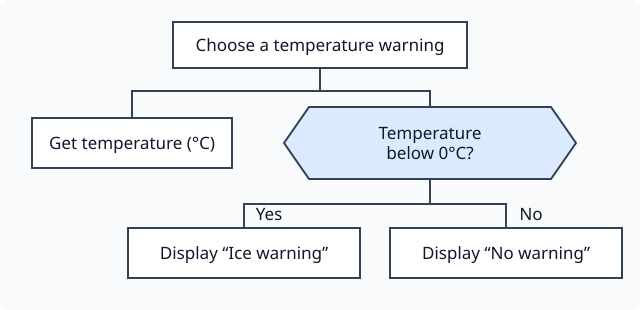
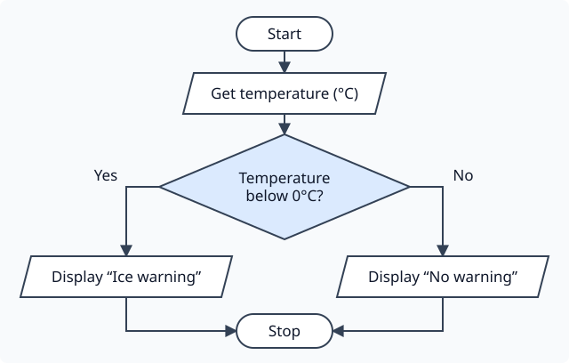
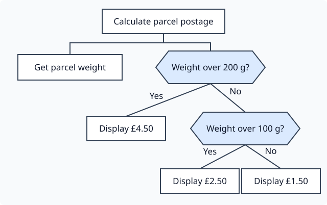
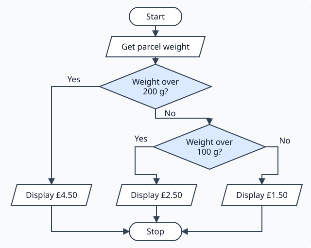
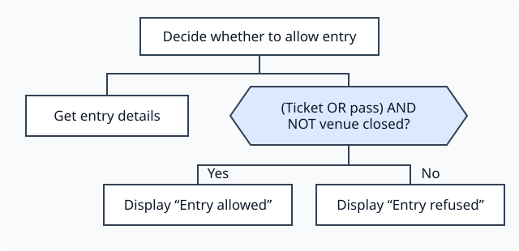
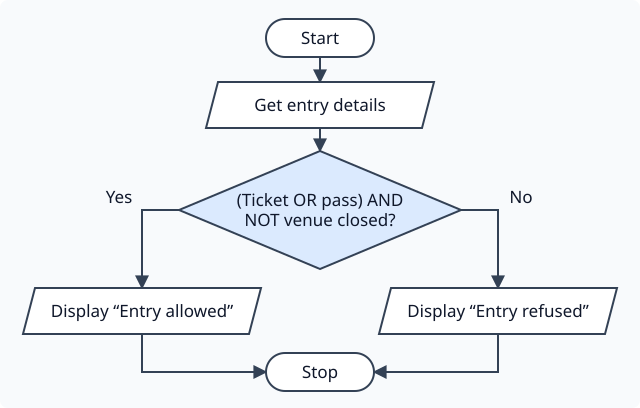

# Selection

!!! info "What you need to know"

    You must be able to identify and describe selection in structure diagrams, flowcharts and pseudocode.

**Selection** means choosing which instructions to carry out based on a condition. A structure diagram uses a **hexagon** to show a choice between branches. A flowchart uses a **diamond** and labels its outgoing arrows **Yes** and **No**.

## Two-way selection (`if`, `else`)

Use `if` and `else` to choose between two actions. This example displays a warning when the temperature is below 0°C and a different message otherwise.

### Structure diagram

<figure markdown="span">
  
</figure>

### Flowchart

<figure markdown="span">
  
</figure>

### Pseudocode

**Algorithm**

```text
1 Get temperature in degrees Celsius
2 Choose the warning message
```

**Refinement**

```text
2.1 If temperature is less than 0
2.2     Display "Ice warning"
2.3 Else
2.4     Display "No warning"
2.5 End if
```

At exactly 0°C, follow the **No** branch because the test uses *less than*.

## Multi-way selection (`if`, `elif`, `else`)

Use `elif` (short for *else if*) to test another condition when the previous test is false. The first true condition chooses the branch. The `else` branch runs when all tests are false.

This example chooses a postage price based on the parcel weight in grams.

### Structure diagram

<figure markdown="span">
  
</figure>

### Flowchart

<figure markdown="span">
  
</figure>

### Pseudocode

**Algorithm**

```text
1 Get parcel weight in grams
2 Choose and display the postage cost
```

**Refinement**

```text
2.1 If weight is greater than 200
2.2     Display "£4.50"
2.3 Else if weight is greater than 100
2.4     Display "£2.50"
2.5 Else
2.6     Display "£1.50"
2.7 End if
```

Check **over 200 g** first. A parcel weighing 250 g meets both weight tests, so testing **over 100 g** first would give it the wrong price.

## Complex conditional statements (`and`, `or`, `not`)

| Operator | When the test is true |
| --- | --- |
| `and` | Both conditions are true. |
| `or` | At least one condition is true. Both may be true. |
| `not` | The condition it applies to is false. |

In this example, entry is allowed when the visitor has **a ticket or a pass**, and the venue is **not closed**. The brackets group the ticket and pass tests together.

### Structure diagram

<figure markdown="span">
  
</figure>

### Flowchart

<figure markdown="span">
  
</figure>

### Pseudocode

**Algorithm**

```text
1 Get ticket, pass and venue details
2 Decide whether to allow entry
```

**Refinement**

```text
1.1 Get whether the visitor has a ticket
1.2 Get whether the visitor has a pass
1.3 Get whether the venue is closed

2.1 If (visitor has a ticket OR visitor has a pass)
       AND NOT (venue is closed)
2.2     Display "Entry allowed"
2.3 Else
2.4     Display "Entry refused"
2.5 End if
```

A visitor with just a pass can enter when the venue is open. If the venue is closed, entry is refused even if the visitor has both a ticket and a pass.
