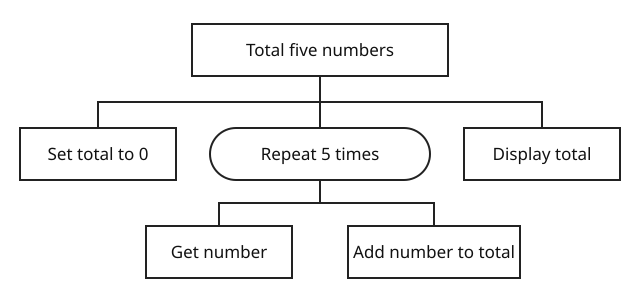
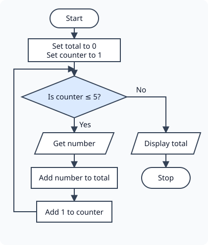
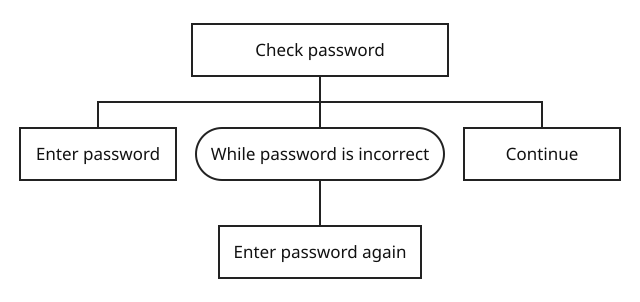
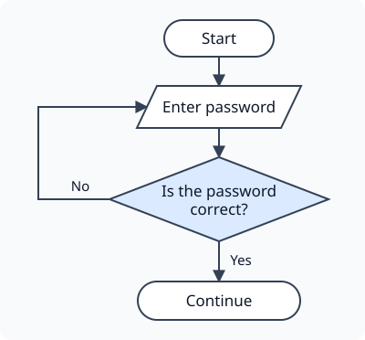

# Iteration

!!! info "What you Need to Know"

    You must be able to identify and describe fixed and conditional loops in structure diagrams, flowcharts and pseudocode.

**Iteration** means repeating a set of instructions. Each pass through the loop is one iteration.

## Fixed loops (`for`)

Use a fixed loop when you know how many times the instructions should repeat before the loop starts. This example reads five numbers and displays their total.

### Structure diagram

Read from top to bottom and left to right. The rounded loop box says **Repeat 5 times**. Both tasks below it run on each pass. **Display total** is a separate branch, so it runs once after the loop.

<figure markdown="span">
  { width="640" }
</figure>

### Flowchart

The counter starts at 1. After each number is added, the counter increases by 1 and the arrow returns to the decision. When the counter reaches 6, the **No** branch displays the total.

<figure markdown="span">
  { width="420" }
</figure>

### Pseudocode

**Algorithm**

```text
1 Initialise total
2 Start fixed loop 5 times
3     Get number from user
4     Add number to total
5 End fixed loop
6 Display total
```

**Refinement**

```text
1.1 Set total to 0

4.1 Add the number entered to the current total
4.2 Store the result in total
```

## Conditional loops (`while`)

A `while` loop checks its condition before each pass. In this example, the program asks for a password once before the loop, then asks again while the password is incorrect. If the first password is correct, the loop body runs zero times.

### Structure diagram

The rounded box gives the condition **While password is incorrect**. Only **Enter password again** sits below the loop box. The first password entry and **Continue** sit on separate branches.

<figure markdown="span">
  { width="640" }
</figure>

### Flowchart

The decision tests whether the password is correct. **No** returns to the password input, and **Yes** continues. This gives the same behaviour as asking again while the password is incorrect.

<figure markdown="span">
  { width="400" }
</figure>

### Pseudocode

**Algorithm**

```text
1 Get password from user
2 Keep asking while the password is incorrect
3 Display access message
```

**Refinement**

```text
2.1 Start conditional loop while password is different from correctPassword
2.2     Get a new password from user and store it in password
2.3 End conditional loop

3.1 Display "Access granted"
```

The variable `correctPassword` holds the expected password. A new input updates `password` before the condition is checked again.
