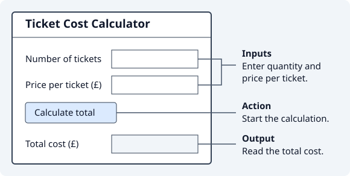

# Design a program interface

A **wireframe** is a simple sketch that shows how the user will interact with a program. Draw the controls, give them clear labels and annotate what each one does.

## Worked example: Ticket cost calculator

!!! example "Brief"

    A customer enters the number of tickets and the price of one ticket in pounds. When they choose to calculate, the program multiplies these values and displays the total cost in pounds.

<figure markdown="span">
  
</figure>

| Element | How it follows from the brief |
| --- | --- |
| **Number of tickets** | The customer enters the quantity to buy. The label identifies which number the program expects. |
| **Price per ticket (£)** | The customer enters the cost of one ticket. The label gives the unit. |
| **Calculate total** | The button starts the calculation after the two inputs have been entered. |
| **Total cost (£)** | The result area displays the calculated amount. The customer reads this value. |

For example, if the customer enters `3` tickets at `£4.50` each, the program displays a total of **£13.50** after they select **Calculate total**.

## Have a go

A pupil enters the marks from three quizzes. When they choose to calculate, the program displays their average mark. Sketch a wireframe with labels for all three inputs, a control to start the calculation and an output area. Annotate what each part does.

??? example "Reveal model answer"

    ```text
    +--------------------------------+
    | Quiz Average                   |
    |                                |
    | Quiz 1 mark     [          ]   |
    | Quiz 2 mark     [          ]   |
    | Quiz 3 mark     [          ]   |
    |                                |
    | [ Calculate average ]          |
    |                                |
    | Average mark    [ result   ]   |
    +--------------------------------+
    ```

    Each quiz has its own labelled input box. **Calculate average** tells the program to add the three marks and divide the total by three. **Average mark** is a read-only output. For example, marks of 6, 8 and 10 give an average of 8.

[Next lesson — Introduction to Python Input and Output](../2.4-implementation/01-input-output/1.1-input-output.md)
